# Design review

375px-wide screenshots of the built site (`design/shots/`, taken with `node design/screenshot.mjs` against `vite preview`) next to the Letterboxd reference screens from Mobbin (`design/refs/`). Each section lists where we differ and why.

## Home grid

| Ours | Reference |
|---|---|
| 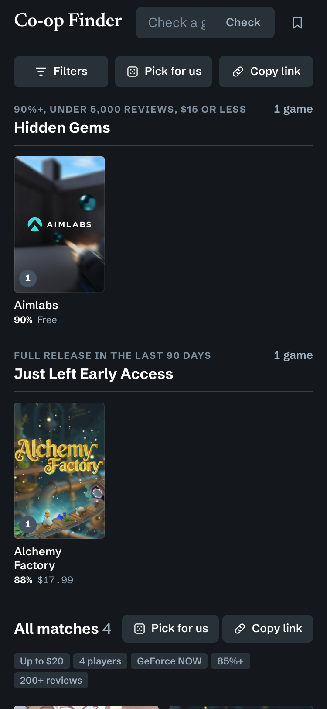 | 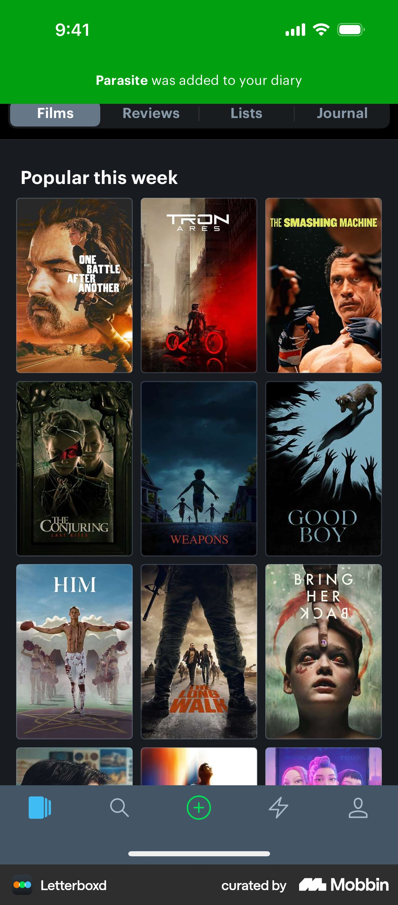 |

Same: dark slate page, a short uppercase label above a bold white section title, hairline under the header, 4px radius posters with a faint inner border, dense art-first layout, grey-blue metadata.

Differences:
- **Two poster columns with text under each, not three bare posters.** The brief requires ten facts per card (price with discount, review % and count and label, co-op chips, player count, badges, tags, the curated line, the group cost). Three columns at 375px leaves 105px per card, too narrow for that text, so the grid is two columns with the text set at 11-13px. The horizontal rows above the grid keep the reference's poster-only look.
- **No segmented Films / Reviews / Lists / Journal tabs.** We have one browse view; the segmented control pattern is used inside the filter sheet instead (party size, minimum %, minimum reviews).
- **A tools strip (Filters, Pick for us, Copy link) sits where the reference has nothing**, because the reference's filter lives behind a toolbar icon in a bottom tab bar, and we have no bottom tab bar (a web page should not fake one).
- **Rows carry a right-aligned count ("12 games")** in place of the reference's implicit "see all" affordance.
- **The brand is a serif wordmark**, not a logo: the brief bans anything like the three-dot mark.

## Home rows

| Ours | Reference |
|---|---|
| 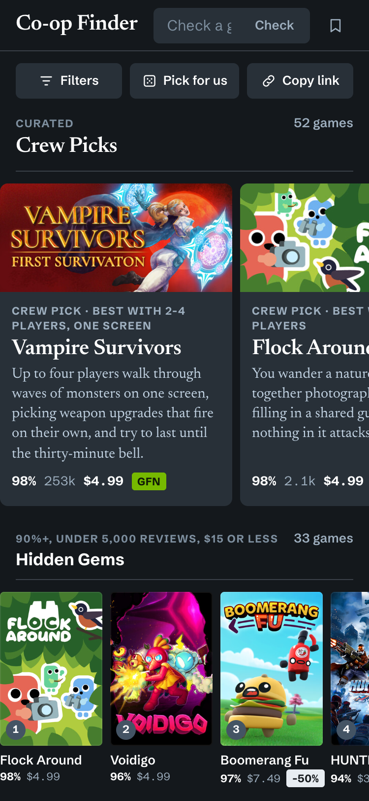 | 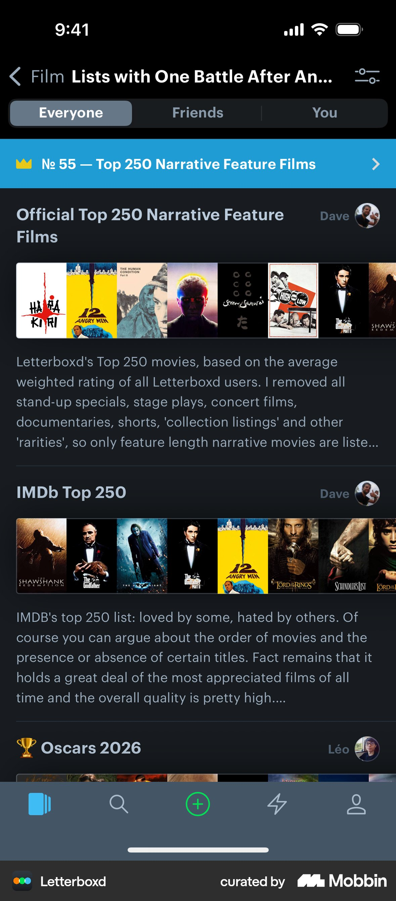 |

Same: a title, then a horizontal strip of posters, repeated per row, hairlines between rows.

Differences:
- **Posters are a scrolling strip with a one-line caption (name, %, price)**, where the reference shows a fixed fan of overlapping posters with a paragraph of list description. Our rows are rankings, not user lists, so each poster needs its own caption and a rank badge.
- **Crew Picks uses the editorial card** (header art, uppercase label, serif title, the curated line) rather than a poster strip, because that row is the one place with hand-written copy; see the next section.

## Crew Picks editorial card

| Ours | Reference |
|---|---|
|  | 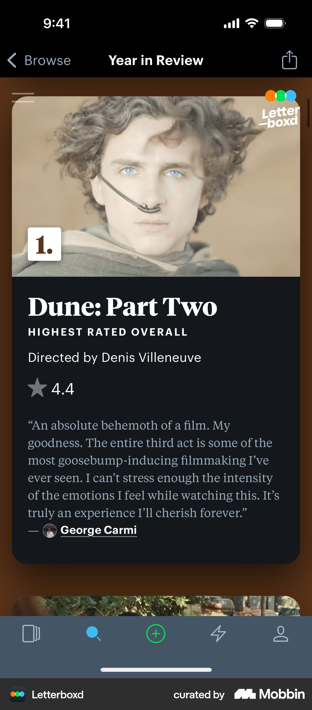 |

Same: wide art on top, a small uppercase label, a large serif title, a serif body line, a few plain facts underneath.

Differences:
- **Cards sit in a horizontal strip at 236-272px wide** rather than one full-width card per screen, because there are 40-60 picks and the home page must stay scannable.
- **No rank number on the art and no quote attribution**: the lines are the maintainer's, not members' reviews.
- **The uppercase label reads "Crew pick · best with 2-4 players"** when PCGamingWiki gives a count; the reference's label is a category ("Highest rated overall").

## Game detail

| Ours | Reference |
|---|---|
| 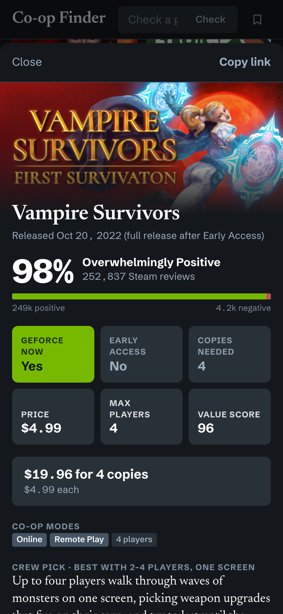 | 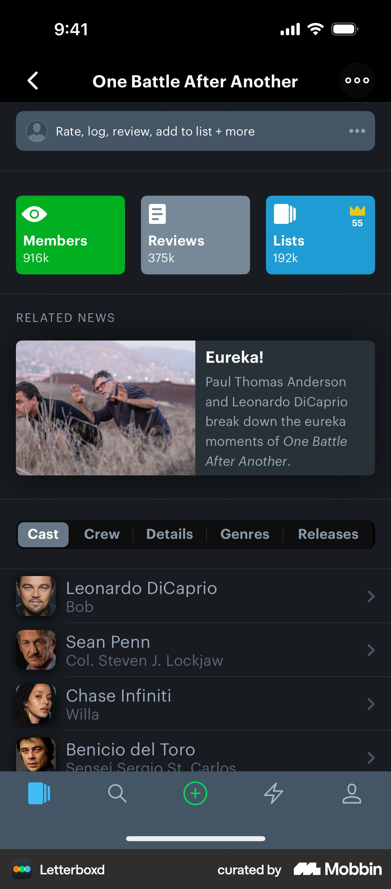 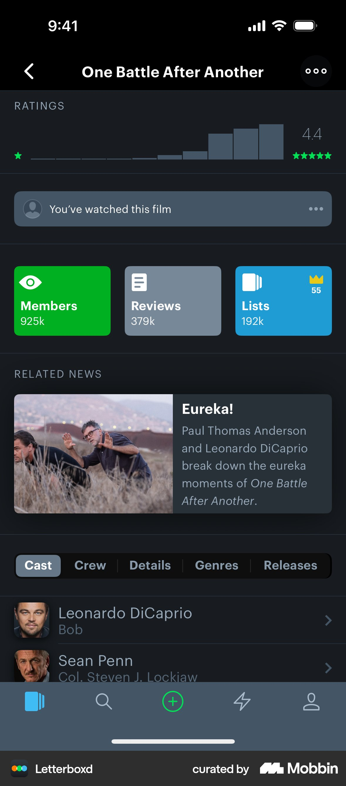 |

Same: a big score beside its label, an uppercase "ratings" style label, a horizontal distribution under the score, a 3-up grid of solid coloured stat tiles, uppercase section labels with hairlines, then lists of pills.

Differences:
- **A two-segment positive/negative bar replaces the five-bucket star histogram.** Steam reviews are thumbs up or down; a histogram of two bars would be a fake distribution.
- **Six tiles instead of three**, because the brief's verdict needs GeForce NOW, Early Access, copies needed, price, max players and value in one glance. Tile colour means something: green only when the game runs on GeForce NOW, orange only when it is Early Access, blue only when one copy is enough; neutral tiles stay slate.
- **Header art is landscape** (Steam's header image) with a fade into the page, where the reference uses a backdrop still. Same device, different source.
- **Actions are full-width buttons** (store page, `steam://`, shortlist) instead of the reference's "Rate, log, review" row, which has no equivalent here.
- **Opens as a bottom sheet on phones and a right side sheet on desktop** rather than a pushed page, so the filtered list underneath is never lost.

## Check a game results

| Ours | Reference |
|---|---|
| 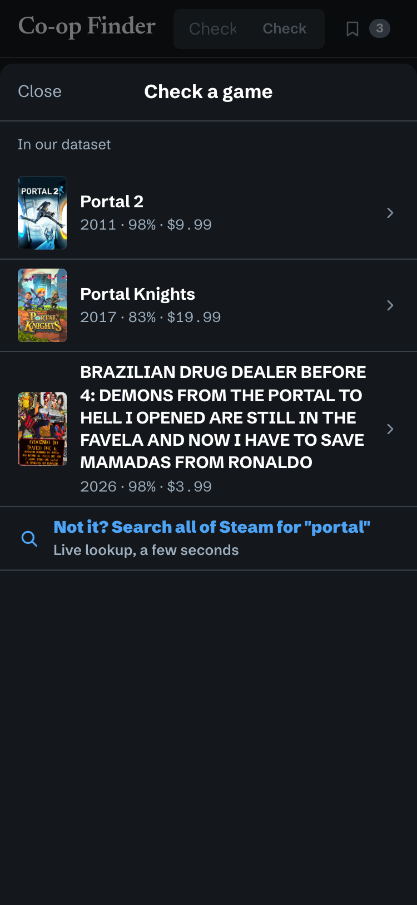 | 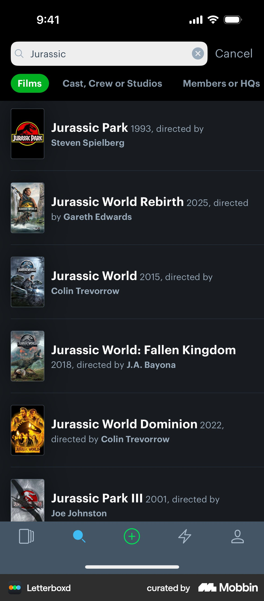 |

Same: a list of rows with a small poster, a bold title, grey metadata, hairlines between rows.

Differences:
- **No Films / Cast / Members scope tabs**; the scope is implied by two labelled groups, "In our dataset" and "On Steam", with the second fetched live only on request (it costs a function call).
- **A chevron on each row**, since a row leads to a verdict card rather than a page.
- **The result is a verdict card** (headline, six tiles) that reuses the detail components, not a film page.

## Shortlist

| Ours | Reference |
|---|---|
| 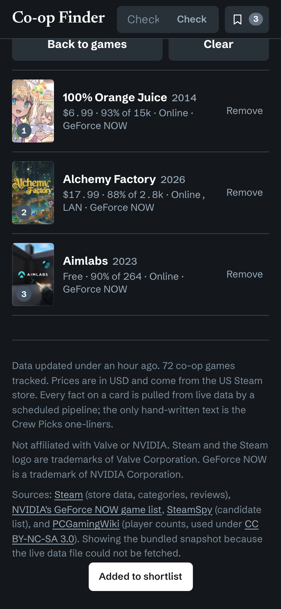 | 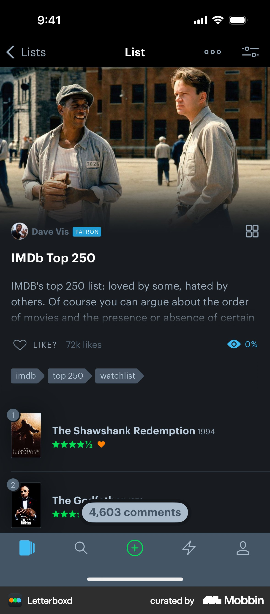 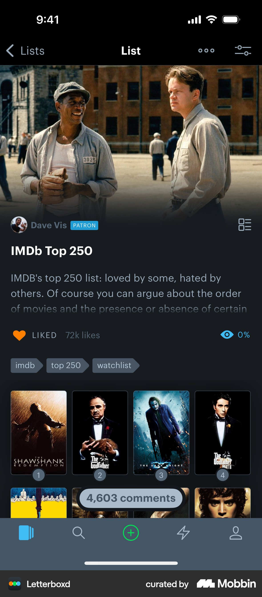 |

Same: header art with a fade, a serif list title, a grey metadata line, a row of tag pills, ranked rows with a numbered badge on the poster, a thumbnail plus bold title plus year plus grey metadata per row, hairlines.

Differences:
- **The header art is the first game's header image**, not a chosen backdrop, because the list is the user's own and has no curated art.
- **Pills are the co-op modes present in the list**, not free-form list tags.
- **Row actions are "Remove" text buttons**, not the reference's red minus circles and drag handles; there is no reordering in v1.
- **Two primary actions (Copy for group chat, Back) sit above the rows**, since copying the list into a chat is the whole point of the page.

## Filter sheet

| Ours | Reference |
|---|---|
| 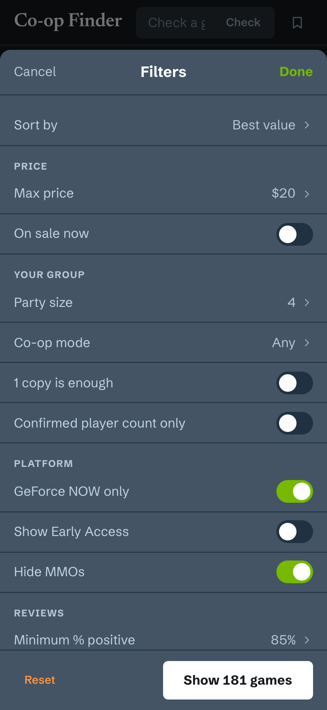 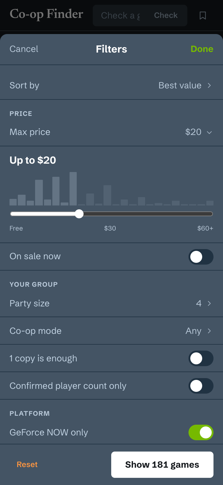 | 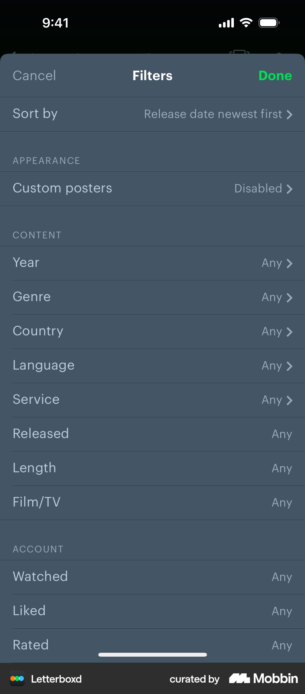 |

Same: a lighter slate sheet over the page, Cancel / Filters / Done header with Done in the accent, grouped rows under small uppercase labels, the current value plus a chevron on the right, hairlines between rows, Reset in orange.

Differences:
- **Switches appear inline on binary rows** (On sale now, 1 copy is enough, GeForce NOW only, Show Early Access, Hide MMOs, Confirmed player count only). The reference pushes every value to a second screen; a web sheet with twelve rows would be slower to use that way.
- **Rows expand in place** (accordion) to show their control: an option list for Sort, a segmented control for party size and the review thresholds, pill groups for modes and tags, and the price histogram. Same reason.
- **A footer button with the live count ("Show 214 games")** comes from the Airbnb reference, as the brief asked.
- **The price control is a histogram with a single max-price thumb** (we only cap the top end), restyled in our tokens: slate bars, the in-range part brighter, "Up to $20" as the value. Airbnb's two-thumb range, pink bars and min/max inputs are not copied.
- **On desktop the same rows live in a sticky left rail**, applied immediately with no Cancel / Done.

## Price display

| Ours | Reference |
|---|---|
| (see the grid cards above) | 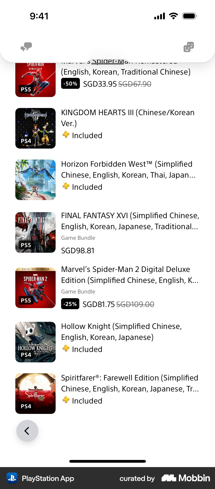 |

Same: current price in bold, base price struck through in a lighter weight, a solid light badge with dark text reading "-38%".

Differences: the badge is light grey-blue (`--badge`) rather than PlayStation's black-on-white or the store's yellow, so it stays neutral against the slate.

## Banned-list check

Run against the built CSS (`dist/index.html`, which inlines the stylesheet) and the UI copy (`src/`, `index.html`): no Inter, Geist, Roboto, Space Grotesk, Satoshi, Manrope, Fraunces or Bricolage; no purple, indigo or violet hues (every colour is a token in `src/styles/tokens.css`, listed in DESIGN.md); no gradient text, glass, glow or blob backgrounds (the only gradients are the two solid-to-transparent fades under hero art); no em dashes in copy. The script is `design/banned-check.sh`; its output from the final build on 13 November 2026:

```
== banned fonts in built output and source ==
none
== purple / indigo / violet (names and hue ranges) ==
no named purples
no hex colours between hue 250 and 320
== em dashes in copy ==
none
== gradient text / glass / glow ==
none
```

Steam's own descriptions can contain em dashes; the pipeline and the checker function replace them with plain dashes before they reach a card.

## Lighthouse (mobile, production build, 13 November 2026)

| Performance (median of 5) | Accessibility | Best practices | SEO | FCP | LCP (median of 5) | TBT | CLS |
|---|---|---|---|---|---|---|---|
| 94 (runs: 84, 91, 94, 95, 96) | 100 | 100 | 100 | 1.5 s | 3.1 s (runs: 2.7 to 4.6 s) | 13 ms | 0.01 |

The LCP element is the first Crew Picks header image, which the build preloads from index.html; the data file is fetched only after that image has loaded (DECISIONS.md 34). Single runs vary by about plus or minus 6 points on this machine, which is why the median is reported. The remaining Lighthouse notes are Steam's JPEG posters (no WebP or smaller portrait size exists on Steam's CDN) and the grid's DOM size at 60 cards.
